# Life Manager 2

简体中文 | [English](README.en.md)

> 版本与变更记录见 [CHANGELOG.md](CHANGELOG.md)。应用版本 **1.34.0**，
> 数据结构 **v4**（旧库启动时自动升级，升级前自动备份）。

一个供单人本地使用的 Windows 桌面应用：把同时推进的人生事务**外置化、结构化、可视化**。
树负责秩序，网负责联系，时间负责记录变化，热力图负责展示真实活动，重点置顶负责决定当下行动。

不是待办清单，不是网页应用，不是多人协作工具。

## 界面一览

下面的截图全部来自本程序的实际运行，数据由 `tools/seed_demo.py` 生成（一年多、1500 多条记录的使用痕迹），不是真实个人记录。

**总览**：最大的那张是总热力图（全部领域与进程汇总），下面是当前重点、快速记录、各领域热力图与最近活动。

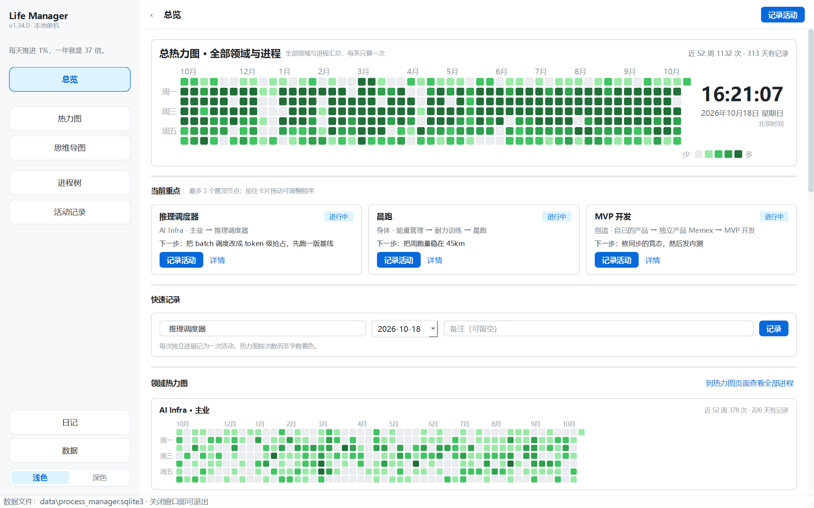

| 热力图：领域 / 进程 / 线程逐层展开 | 思维导图：单击卡片即可记录 |
|---|---|
| 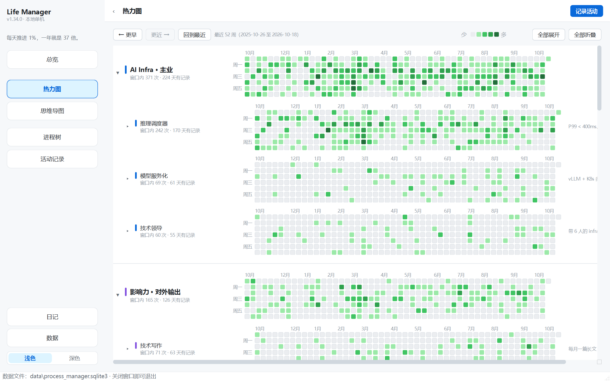 | 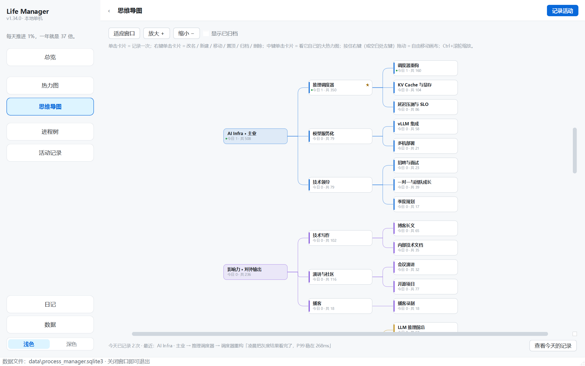 |

| 活动记录：按天分开，可改可删 | 进程树：三层结构 + 变化历史 |
|---|---|
| 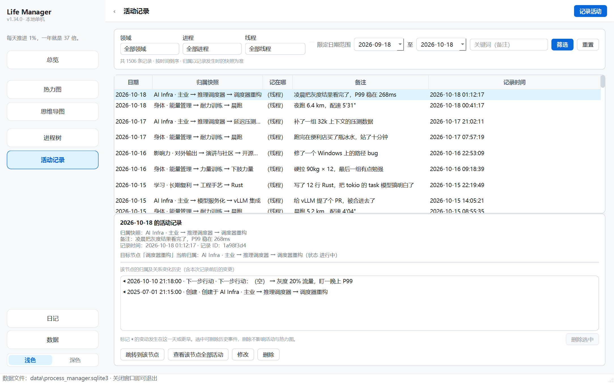 | 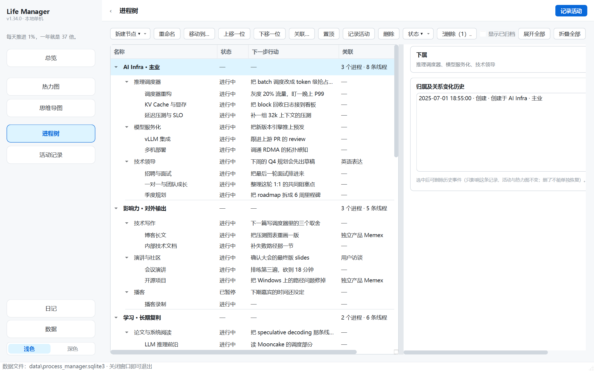 |

| 日记：每天一篇，写进本地 Markdown | 数据：备份 / 恢复 / JSON / CSV 导出 |
|---|---|
| 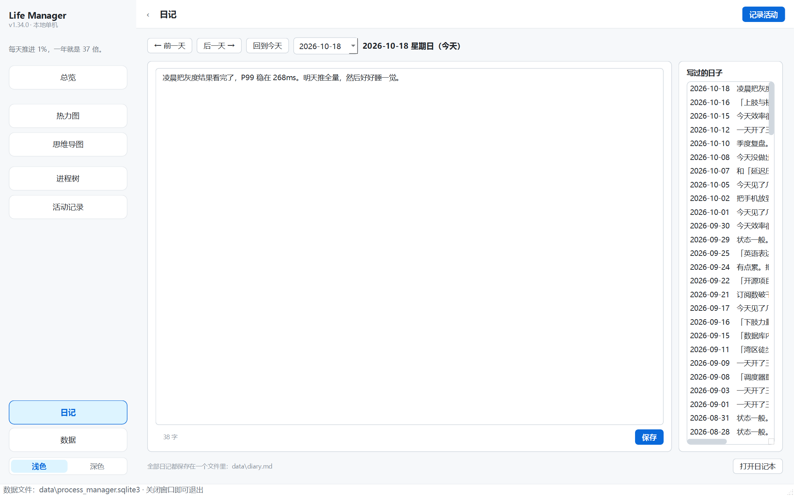 | 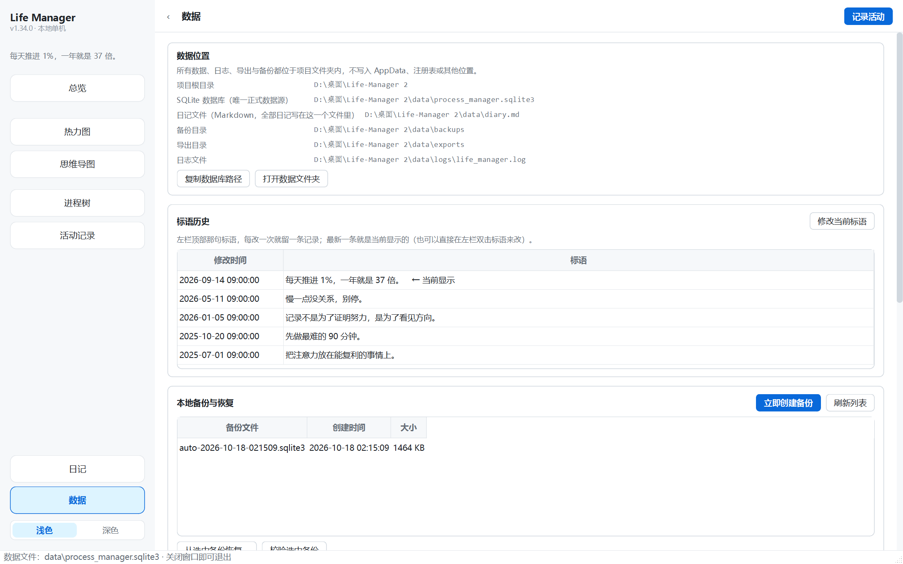 |

**点开任意一张热力图**，在大图里点某一天的格子，那天的记录会直接列在下方（可修改、可彻底删除）：

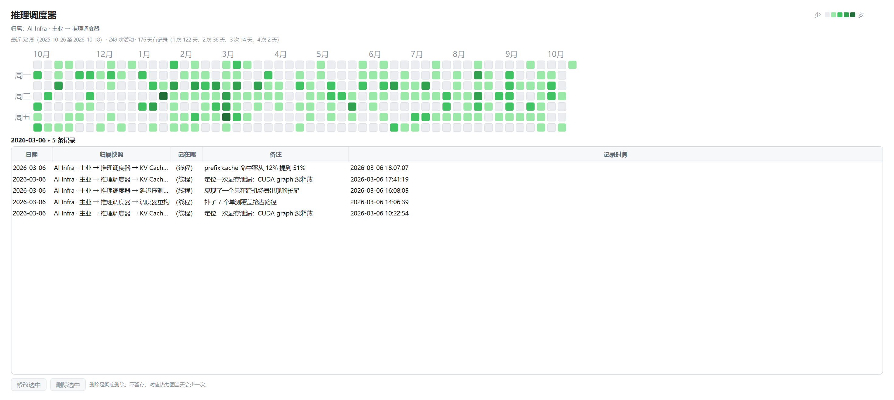

**深色模式**（左栏底部切换，配色对齐 GitHub Dark）：

| 总览 | 热力图 |
|---|---|
| 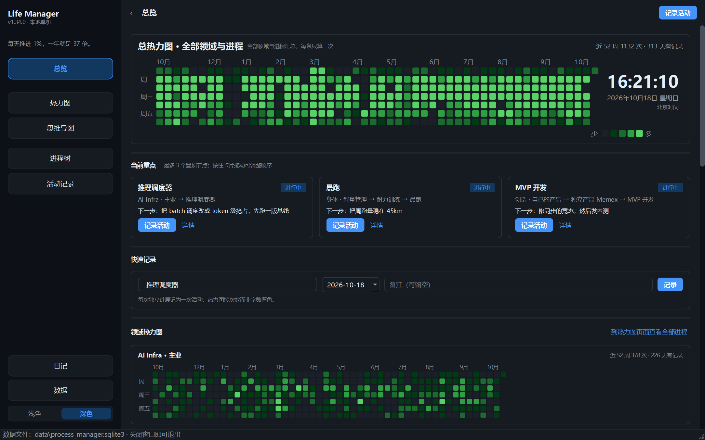 | 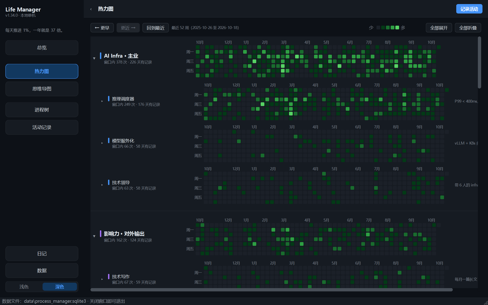 |

**`Ctrl+N` 快速记录**：先模糊匹配节点，回车选中，再写备注，再回车保存——只有一个输入框。

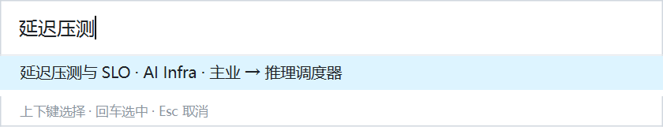

---

## 一、快速开始

### 日常启动

双击项目根目录下的 `启动.pyw`。

- 打开独立桌面窗口，不弹出 CMD / PowerShell 窗口；
- 不打开浏览器，不启动本地 Web 服务器；
- 不需要输入任何命令；
- 关闭窗口即退出，数据自动保存。

### 首次运行：环境准备

首次双击 `启动.pyw` 时会弹出一个「首次环境准备」向导（因为 `PySide6` 还没装）。点击**开始准备环境**即可，向导会自动：

1. 在项目文件夹内创建 `.venv`（独立虚拟环境，不修改系统 Python）；
2. 安装唯一依赖 `PySide6-Essentials`（约 80MB，需要联网一次）；
3. 校验通过后直接启动应用。

如果向导里的自动准备失败，按窗口里给出的提示在项目文件夹执行一次即可：

```powershell
py -3.13 -m venv .venv
.venv\Scripts\python.exe -m pip install -r requirements.txt
```

要求：64 位 Python 3.9 及以上（本机已装 3.13 与 3.11，向导会自动挑选）。
不要求打包 EXE；不要求联网，只有首次安装依赖需要网络。

---

## 二、界面导览

左侧导航是六个彼此独立的圆角按钮、整组垂直居中在左栏中间（「数据」固定在最下面），
左栏可以整体收起（顶栏 `☰` 按钮切换），快捷键 `Ctrl+1` ~ `Ctrl+7` 直接跳页。
最底下是**配色切换**（浅色 / 深色两段，当前主题会被记住）；深色模式对齐 GitHub Dark。
快捷键：`Ctrl+N` 快速记录一次活动、`Ctrl+M` 快速记一句日记（都是极简弹窗）。

左栏标题下面有一条**标语**：**双击就能改**，改一次留一条历史；以前的版本在「数据」页面的
「标语历史」里能看到。没写过的时候只显示一句灰字提示，不占地方。
窗口的位置与大小会在关闭时记住、下次启动原样恢复，并自动校正到屏幕可用区域内；
也可以在「数据」页面勾选「启动时最大化」。

### 快速记录 `Ctrl+N`

在任意页面按一下 `Ctrl+N`，会弹出一个小面板，**只有一个输入框、两段式**：

1. **先匹配**：输入关键字，模糊挑出一个进程或线程（支持"英单"→"英语单词"这种顺序匹配，
   也支持"主业 精听"这样的多词组合；输入框为空时列出最近记过的几个节点），回车选中；
2. **再写**：同一个输入框改用来写备注，再按一次回车就保存并关闭。备注可留空。

选中之后面板上会写明"记到：领域 → 进程 → 线程 · 今天日期"，避免记错地方。
**只按了第一次回车（还没按第二次）时不会写入任何数据**；`Esc` 随时取消。
顶栏的「记录活动」按钮仍然是完整窗口（可以改日期、可以翻找节点），`Ctrl+N` 是它的极简版。

| 页面 | 内容 |
| --- | --- |
| **总览** | **总热力图（全部领域与进程汇总，放在页面最上方、尺寸明显更大）**、当前重点（最多 3 个置顶，含名称、主要归属、状态、下一步行动）、快速记录、三个 Area 的热力图、最近活动 |
| **日记** | 每天一篇，写不写都行。默认打开「今天」，新的一天编辑框是空的；可以翻前后日期、点右侧「写过的日子」回看；切走页面自动保存。全部日记写进 `data/diary.md` 一个 Markdown 文件（按「月 → 日」倒序排列，顶部有只列到年月的可跳转目录），右下角「打开日记本」可直接用系统默认程序打开它 |
| **思维导图** | XMind 风格的思维导图。**单击卡片 = 弹出记录窗口**（日期默认今天，点了「记录」才生成数据）；**中键单击卡片 = 看它自己的大热力图**（右键菜单里也有「看大热力图…」这一项）；**右键单击卡片** = 改名 / 新建进程或线程 / 移动 / 置顶 / 编辑下一步行动 / 归档 / 删除；**按住鼠标右键拖动 = 自由移动画布**（空白处左键拖动同样可以；中键不参与拖画布）；卡片上直接显示「今日 n · 共 m」；`Ctrl+滚轮` 缩放，滚轮上下滚动 |
| **进程树** | Area → Process → Thread 完整树；**同一层内可以拖动调整顺序**（也有「上移一位 / 下移一位」按钮，顺序会同步到记录地图与热力图）；新建 / 重命名 / 移动到 / 关联 / 置顶 / 状态切换 / 归档；右侧详情含归属、关联、下一步行动、近期活动、归属及关系变化历史 |
| **热力图** | **一行一个节点**（领域 → 进程 → 线程）：左边色条 + 名字 + 一句统计，右边一张热力图；**点任意一行打开全屏大图**，在大图里点某一天的色块，**那天的活动记录就直接显示在大图下方**（可改备注、改日期、彻底删除）；领域可折叠，**线程默认收起（「全部展开」也不会展开它，只能点进程左边的三角）**，窗口可前后翻页 |
| **活动记录** | 按时间倒序，支持按 Area / Process / Thread、日期范围、关键词筛选；可查看每条记录发生时的归属快照与该节点的归属变更历史 |
| **数据** | 数据库位置、手动备份、从备份恢复、JSON 导入导出、**导出某个节点的全部活动记录（CSV）**、标语历史、数据完整性检查 |

**热力图**为 GitHub 贡献图样式：方格 11px、间距 3px、圆角 2px；横向按周、纵向按星期（周日在上）；
顶部月份标记，左侧周一/周三/周五；默认展示最近 52 周，可向前翻看更早历史；
颜色固定分档 `0 / 1 / 2 / 3 / 4 次及以上`，与 GitHub 相同的绿色阶梯。
悬停显示日期、次数与摘要，点击方格查看当天全部记录。

---

## 三、时间与校准（全项目统一北京时间）

- 唯一时间来源是 `app/clock.py`，时区固定为 **UTC+8**；有测试扫描源码，
  禁止其它模块直接调用 `datetime.now()` / `date.today()`。
- **不联网校准**。应用读取的是系统时钟给出的绝对时间（UTC），再按 +8 换算成北京时间，
  所以即使 Windows 的时区设成别的城市，记录与显示仍然是北京时间。
- 时间准不准取决于系统时钟。Windows 默认会自己联网对时：
  设置 → 时间和语言 → 日期和时间 → 打开「自动设置时间」，必要时点「立即同步」。
- 如果你希望应用自己联网对时（NTP），那需要访问外部时间服务器，会突破「完全本地」这条规则，
  需要先改规则再做。

---

## 四、四条不可违背的规则如何落地

### 规则一：关联不等于归属

- 每个 Thread 有一个主要归属（树中的父节点），可另外关联任意多个 Process；
- 热力图统计只看活动记录里的 `area_id` / `process_id` 快照，关联关系**完全不参与统计**；
- 因此一条活动只会出现在「它当时所属的 Process」和「对应 Area」两张热力图里，不会因为关联而重复计数。

### 规则二：归属变更必须保留历史

- 活动记录在创建时写入归属快照：`area_id`、`process_id`、`thread_id` 以及完整路径 `path_snapshot`（含当时的节点名称）；
- 移动线程 / 移动进程**不会**改写任何已有活动记录，历史热力图保持不变，后续新活动才使用新归属；
- 每次移动、重命名、状态变化、置顶、关联/解除、下一步行动变更都会追加一条历史事件（只追加，不覆盖）；
- 移动操作在**同一个 SQLite 事务**里完成：更新树、写入事件、保持旧快照不变，任一步失败整体回滚。

### 删除与恢复（一条硬规则：留就必须能恢复）

| 操作 | 数据库里还留着吗 | 能恢复吗 |
| --- | --- | --- |
| 删除一条活动记录 | 不留 | 不能（彻底删除，热力图当天随之少一次） |
| 删除一条历史事件 | 不留 | 不能 |
| 删除节点（线程 / 进程 / 领域） | 留：活动记录、归属快照、热力图统计、历史事件全在 | 能：「已删除」清单里随时恢复 |
| 归档节点 | 留：在树里灰显（勾「显示已归档」可见） | 能：改回其它状态即可 |
| 从备份恢复 | 留 | 能（整体回滚，恢复前还会自动备份当前数据） |

删除节点不会让热力图少任何一次：线程的活动继续计入上层进程与领域；被删进程的数据保留在领域热力图中，
并在热力图页面标注「含已删除进程：某某 N 次」；被删的领域与进程自己的热力图仍可在
「已删除（数据保留）」分组里查看。

### 规则三：完全本地、单人使用

> 将来如果开放联网 AI，必须遵守 [docs/AI-功能草案.md](docs/AI-功能草案.md) 里的联网红线
> （默认关闭、发送前预览、只发你手输的文字与节点清单）。**目前没有实现，规则三照旧。**

- 无账号、无后端、无云端同步、无远程 API、无遥测；
- 不使用 `requests` / `urllib` / `socket` / 浏览器等任何网络或 Web 组件（有测试自动检查）；
- 所有数据、日志、导出、备份、配置都在项目文件夹内（`data/`），不写 AppData、Documents、注册表；
- 窗口大小、侧边栏折叠等设置保存在 `data/config.json`，不使用会写注册表的 `QSettings`；
- 断网可完整使用。

### 规则四：优先使用 `.pyw` 启动

`启动.pyw` 是唯一日常入口：先检测项目内 `.venv` 是否就绪，就绪则用 `.venv` 的 `pythonw.exe`
以无控制台方式拉起应用；未就绪则弹出图形化环境准备向导。全程不出现命令行窗口。

---

## 五、空白启动

这是一份**空白副本**：首次启动只建好表结构（领域 → 进程 → 线程 + 活动记录 + 归属历史），
不会写入任何领域、进程、线程、关联或示例活动。打开后第一件事是去「进程树」→「新建节点」
建立自己的领域。

> 原版会在空库时写入一套占位模板；这份副本在 `app/main.py` 里显式关掉了初始化数据
> （`db.initialize(seed=False)`），并把 `seeded` 标记写进数据库，所以以后也不会突然冒出模板。

### 想要一份现成的演示数据？

仓库里带了 [`demo/`](demo/)：一份**虚构的**数据库快照（15 个月、1500+ 条记录、8 个领域、170 天日记）。
它和 `data/` 是分开的——`data/` 永远不进 Git，`demo/` 只是可选的样例。

用法见 [demo/README.md](demo/README.md)：复制到 `data/backups/` 后在「数据」页恢复，或直接替换数据库。
想按当天重新生成也可以：`.venv\Scripts\python.exe tools\seed_demo.py --force`。

---

## 六、目录结构

```
Life-Manager-2/
├── 启动.pyw                  ← 日常双击入口（环境检测 + 无控制台启动）
├── requirements.txt
├── README.md / README.en.md  ← 中英文说明
├── CHANGELOG.md
├── assets/
│   ├── logo.png              ← 应用图标源图
│   └── logo.ico              ← 多尺寸图标（任务栏 / 标题栏用，由 tools/make_icon.py 生成）
├── app/
│   ├── main.py               ← 应用入口（日志 / 数据库 / 主窗口 / 主题重建）
│   ├── main_window.py        ← 主窗口与可收起的左侧导航
│   ├── paths.py              ← 项目内路径解析（全部相对项目根目录动态计算）
│   ├── models.py             ← 数据模型与枚举
│   ├── storage.py            ← SQLite 表结构、迁移、事务、完整性检查
│   ├── services.py           ← 业务逻辑（节点 / 关联 / 活动 / 历史事件 / 备份 / 导入导出）
│   ├── heatmap.py            ← 热力图统计与日历网格计算（纯 Python，可无头测试）
│   ├── diary.py              ← 日记 Markdown 的解析与渲染
│   ├── clock.py              ← 唯一的北京时间来源
│   ├── theme.py              ← 浅色 / 深色配色与样式
│   ├── appconfig.py          ← data/config.json 读写
│   ├── logging_setup.py      ← 日志配置
│   ├── pages/                ← 总览 / 热力图 / 思维导图 / 进程树 / 活动记录 / 日记 / 数据
│   └── widgets/              ← 通用组件、侧边栏、GitHub 风格热力图控件、快速记录
├── demo/                     ← 虚构的演示数据快照（可选，和 data/ 完全分开）
├── data/                     ← 全部应用数据（首次运行自动创建，永不进 Git）
├── docs/screenshots/         ← README 用的界面截图
├── tests/                    ← 自动化测试（218 项）
└── tools/                    ← 界面预览渲染、图标生成、演示数据生成
```

---

## 七、数据库结构

| 表 | 用途 |
| --- | --- |
| `nodes` | Area / Process / Thread，含唯一 ID、名称、父节点、状态、是否置顶、下一步行动 |
| `associations` | Thread ↔ Process 关联，含建立时间与解除时间（解除后保留记录） |
| `activities` | 活动记录：唯一 ID、目标节点、日期、创建时间、备注、**归属快照**（area/process/thread + 完整路径 JSON） |
| `events` | 历史事件：只追加，含变更前后的值或归属路径、事件时间 |
| `meta` | 数据结构版本、初始化标记 |

要点：

- 所有表使用唯一 ID 标识对象，绝不通过名称识别；
- 活动表里的归属快照一经写入不再修改；
- 写入统一走事务（`BEGIN IMMEDIATE` → `COMMIT`，异常回滚）；
- 数据库损坏时**不静默清空**，只提供「打开数据文件夹」或「从备份恢复」两条路径；
- 结构升级前自动在 `data/backups/` 创建 `pre-migration-*` 备份。

---

## 八、常见操作

| 我想… | 怎么做 |
| --- | --- |
| 记录一次活动 | 顶栏「记录活动」，或在总览快速记录、进程树详情里记录。只需选进程/线程 + 可选备注 |
| 顺手记一次（最快） | 页面「思维导图」→ 单击目标卡片 → 填备注 → 「记录」。不想记就点取消，不产生任何数据 |
| 在地图上改结构 | 右键卡片：新建进程/线程、重命名、移动、置顶、归档、删除。写入规则与进程树完全一致 |
| 移动线程到别的进程 | 进程树选中线程 →「移动到…」→ 选目标进程 → 确认。移动前活动仍留在原归属 |
| 移动进程到别的领域 | 同上，目标换成 Area。进程自身热力图保留完整历史，Area 热力图按历史归属分别统计 |
| 建立/解除关联 | 选中线程 →「关联…」，勾选或取消勾选进程 |
| 设置当前重点 | 选中进程或线程 →「置顶」（最多 3 个），总览即时显示 |
| 给进程热力图写注释 | 在「热力图」页面**右键点击进程热力图的标题** → 输入一句注释，它会以浅灰小字显示在标题下面；留空即移除。没有注释的进程不会有任何多余空位 |
| 暂停 / 完成 / 归档 | 选中节点 →「状态 ▾」。归档是软归档，不删除任何历史 |
| 删除节点（线程 / 进程 / 领域） | 选中节点 →「删除」。节点移入「已删除」清单，**活动记录、热力图统计、历史事件全部保留**，随时可恢复 |
| 找回被删除的节点 | 进程树页面 →「已删除（n）…」→ 选中 →「恢复选中」；那里也能查看它的活动记录与热力图 |
| 修改一条活动记录 | 活动记录页面选中记录 →「修改」。可改备注与日期，**归属快照不可改**（它是活动发生时的事实） |
| 删除一条活动记录 | 活动记录页面选中记录 →「删除」。彻底删除、不留存，对应热力图当天随之少一次 |
| 快速改/删一条记录 | 在「活动记录」表格里、或热力图点开某天后的弹窗里，**右键任意一条记录** → 修改备注与日期 / 彻底删除 |
| 删掉某一天的日记 | 日记页右侧「写过的日子」里**右键那一天** → 删除；`data/diary.md` 里对应的那一节会一起删掉 |
| 删除某条变化历史 | 进程树右侧「归属及关系变化历史」里选中（可多选）→「删除选中」。只删除这条历史事件，活动记录、归属快照与热力图统计都不受影响 |
| 备份 | 页面 E「立即创建备份」，写入 `data/backups/` |
| 自动备份 | **每天第一次启动时会自动备份一份**（`auto-日期-时间.sqlite3`，日记一起存）。同一天只做一份；应用**不会自动删除任何备份** |
| 恢复 | 页面 E 选中备份 →「从选中备份恢复…」，覆盖前会先把当前库另存为 `pre-restore-*` |
| 导出 / 导入 JSON | 页面 E。导入为覆盖语义，导入前自动备份，文件有问题时保留现有数据 |
| 检查数据 | 页面 E「运行检查」：SQLite 结构、外键、归属类型、活动快照、关联合法性、重复 ID |

---

## 九、测试

```powershell
.venv\Scripts\python.exe -m unittest discover -s tests -t . -p "test_*.py"
```

123 项测试，全部无头运行：

- `tests/test_core.py`：初始分类一致性、热力图分档与去重、关联不影响统计、线程/进程移动后历史保留、事件可读、事务回退、归档不删历史、置顶上限、重开应用数据仍在、备份/恢复、导出/导入、导入失败不动现有数据、完整性检查、所有路径都在项目内、源码不含任何网络库、损坏数据库不静默清空；删除节点后活动与热力图不变、可恢复、老库 v1→v2 升级不丢数据；活动记录可改可删；历史事件可删。
- `tests/test_mindmap.py`：思维导图布局（卡片不重叠、父节点对齐子卡片中点、层级向右展开、空树与单节点）。
- `tests/test_diary.py`：日记文件读写（按日期插入/更新/删除、保持时间顺序、手工写的内容不被覆盖、星期计算）。
- `tests/test_clock.py`：北京时间（UTC+8 固定时区、表盘读数等于 UTC+8、显示格式、扫描源码禁止其它模块直接读系统时间）。
- `tests/test_ui_smoke.py`：六个页面构建与切换、侧边栏收起展开、热力图渲染出四档绿色像素、刷新后不残留旧控件、删除后从树里消失并可在「已删除」里恢复、**在地图记录后活动记录 / 热力图 / 总览 / 进程树同步更新**、活动记录右键菜单、窗口位置与大小记忆与屏幕校正、启动最大化开关。

### 验收标准对照

| # | 验收标准 | 覆盖位置 |
| --- | --- | --- |
| 1 | 初始分类与提供的树完全一致 | `test_tree_matches_specification` |
| 2 | 三个 Area 各自有热力图 | `test_heatmap_page_has_area_and_process_calendars` |
| 3 | 每个 Process 有独立热力图 | 同上（9 个进程热力图） |
| 4 | 按次数显示 GitHub 风格绿色阶梯 | `test_levels_follow_fixed_thresholds`、`test_heatmap_renders_github_green_cells` |
| 5 | 每条 Thread 可关联多个 Process | `test_thread_can_associate_many_processes` |
| 6 | 关联不让活动进入其他 Process 热力图 | `test_activity_lands_in_process_and_area_only` |
| 7 | 移动后旧活动留在 A、新活动进入 B | `test_thread_move_keeps_old_activities_in_old_heatmap` |
| 8 | 移动生成可查看的历史事件 | `test_move_creates_readable_event` |
| 9 | 移动 Process 后两种热力图各自正确 | `test_process_move_across_areas` |
| 10 | 重开后节点/记录/关系/历史都在 | `test_reopen_keeps_everything` |
| 11 | 所有数据在项目文件夹内 | `test_all_paths_live_inside_project` |
| 12 | 双击 `启动.pyw` 打开独立窗口、不弹 CMD | `启动.pyw` 启动器（`.venv` 就绪时用 `pythonw.exe` 拉起） |
| 13 | 可备份、导出、导入、恢复 | `test_backup_and_restore`、`test_export_and_import_json` |
| 14 | 变更不会误删历史 | `test_archive_keeps_history`、`test_rename_keeps_old_snapshot_names`、`test_import_invalid_file_keeps_data` |
| 15 | 断网仍可完整运行 | `test_source_has_no_network_dependencies`（源码中无任何网络库） |

---

## 十、迁移到另一台电脑（整个工具打包带走）

已验证：把项目复制到别的目录后用同一套 Python 跑起来，程序会自动认到**新目录**，
读写新目录里的 `data/`，原目录一个字节都不会被改动（路径全部从项目根目录动态计算）。

步骤：

1. **先关掉应用**（或者先在「数据」页面点一次「立即创建备份」）。
   原因：数据库使用 WAL 模式，应用运行中直接拷文件可能漏掉最近的写入。
2. 复制**整个项目文件夹**，但**不要复制 `.venv`**——
   虚拟环境里写着这台电脑的 Python 绝对路径（`pyvenv.cfg` 里就是 `C:\Users\...`），换机器用不了。
3. 在新电脑上双击 `启动.pyw`：首次运行会弹出环境准备向导，自动创建 `.venv`
   并安装 PySide6（需要联网一次，约 80MB）。
4. 之后每天双击 `启动.pyw` 即可。你的节点、活动、日记、备份都在文件夹里跟着走。

前提与注意：

- 新电脑需要 **64 位 Python 3.9 及以上**（向导会自动挑一个；完全没有 Python 时，
  向导会给出可复制的手动命令）；
- `.pyw` 需要与 Python 关联才能双击。安装 Python 时勾选相关选项即可；
  没关联时右键「打开方式」选 Python，或运行 `pyw 启动.pyw`；
- 整个项目**不写注册表、不写 AppData**，放任何可写目录都能跑（U 盘也行）；
  但**别放在网络盘**上跑，SQLite 在网络文件系统上容易出现锁冲突；
- 复制时如果想带走数据，就连 `data/` 一起复制；想在新电脑上从零开始，就不带 `data/`。
  无论如何，`data/` 都不该进 Git——`.gitignore` 已排除，另有测试盯着。

---

## 十一、开发辅助

```powershell
# 用临时数据渲染各个页面为 PNG（不触碰真实数据），输出到 .preview/
.venv\Scripts\python.exe tools\render_preview.py

# 启动真实窗口并抓图（含逐页截图）
powershell -NoProfile -ExecutionPolicy Bypass -File tools\capture_window.ps1 -SwitchPages

# 换了 assets/logo.png 之后，重新生成多尺寸图标 assets/logo.ico
.venv\Scripts\python.exe tools\make_icon.py
```

---

## 十二、第一版明确不做

云端同步与账号、多人协作、任何网络服务或 API、Git 提交集成、自动计时、
按字数计算热力图、因关联复制活动、按当前目录重算历史归属、
复杂任务拆分、自动生成或删除记录、强制 EXE 打包。

**AI 功能也暂不实现**。如果你以后想做（可以让应用联网调 DeepSeek，但必须严格控制上传内容），
设计与隐私红线已经写在 [docs/AI-功能草案.md](docs/AI-功能草案.md) 里，
把那份文档最后一节那段 prompt 发给 Codex 就能直接开工。

相反，一切以「活动归属按发生时的**事实**记录，而不是按今天的分类重新解释过去」为准；
所有数据留在本地，历史完整可查。
